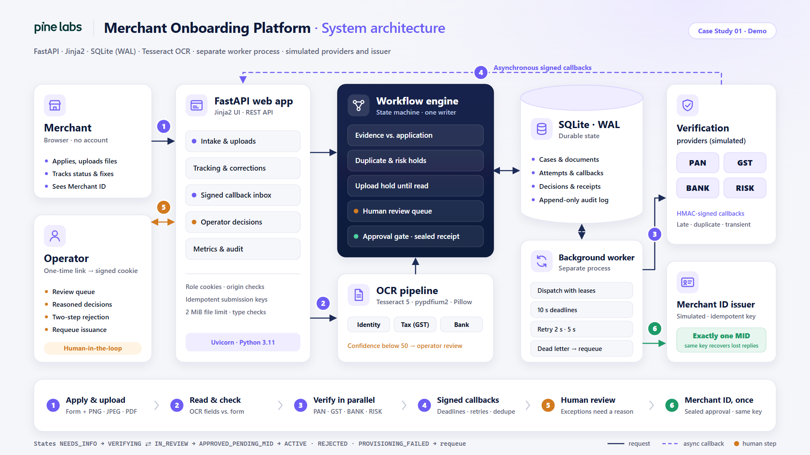

# Autonomous Merchant Onboarding Platform — Pine Labs Case Study 01

Merchant onboarding can stall when a document conflicts with the application, a provider responds late, or an approved merchant never receives an ID. This local application tracks the evidence, outstanding checks and next action for each merchant through issuance.



## How it works

- **Merchant.** Submit synthetic business and bank details with structured evidence or PNG, JPEG and PDF documents. Local Tesseract OCR extracts fields and confidence scores. The tracking page explains how to supply a missing document or replace conflicting evidence.
- **Operator.** Open the private operator link, filter the review queue and inspect the checks and source evidence. Available actions depend on the issue. Requests for corrections, referral decisions and rejections record the reviewer’s reason. Metrics report outcomes, delays and exceptions from stored records.
- **Verification and issuance.** FastAPI serves Jinja2 pages with JavaScript and CSS. A supervised Python worker polls SQLite for due jobs, leases them and dispatches HTTP requests. Signed asynchronous callbacks update the current verification attempts. Deadlines, retries, dead-letter recovery and duplicate detection protect the workflow across restarts.
- **Approval.** The gate requires current evidence and qualifying PAN, GST, BANK and RISK results. A pending replacement blocks approval. Approval seals the evidence and winning attempts in a receipt and queues issuance. The issuer reuses the operation key when a response is lost, so a retry recovers the same Merchant ID.

## Run locally on Windows

Use PowerShell, Git, Python 3.11 and Tesseract with English language data. Install Tesseract once if needed. The Python wrapper also requires the native executable.

```powershell
winget install --id UB-Mannheim.TesseractOCR -e
```

From the repository root, run `cd PineLabs-Case01-Starter`, then execute the following commands.

```powershell
py -3.11 -m venv .venv
.\.venv\Scripts\python.exe -m pip install -r requirements.txt
.\.venv\Scripts\python.exe tools/release_check.py
.\.venv\Scripts\python.exe -m app.run --run-dir private/submission-demo --port 8000 --demo-controls
```

The release checker, privacy scanner and Git-specific tests require a Git checkout. For a standalone folder, skip the release checker and start the launcher directly.

Open [merchant intake](http://127.0.0.1:8000/). Open the single-use operator link from the launcher in a separate browser profile to see both roles independently. The launcher also saves it inside the private run directory. Ctrl+C stops both processes. Restart with the same directory to resume. The launcher runs `python -m app.web` and `python -m app.worker` as separate processes.

## Try the demo

Use synthetic data only. In **Try a demo scenario**, select a fixture and submit it. Use a fresh run directory for independent repetitions because duplicate detection persists across sessions.

| Scenario | What to verify |
|---|---|
| Missing tax evidence | Supply the tax document from the tracking page. Verification resumes and the qualifying case receives one MID. |
| PAN passes, GST fails | The operator sees the GST failure and can request correction or reject. Issuance stays blocked. |
| Risk referral | Review the evidence and select an allowed reason before accepting the referral. Inspect the approval receipt. |
| Duplicate or late callback | Open verification attempts and callback receipts to see how repeats and expired attempts are handled. |
| Issuer acknowledgement lost | Watch issuance recover using the existing operation key. Check the case history and final MID. |

Generate files for the missing-tax scenario, then select the tax PDF on the correction form. To populate the operator queue separately, seed a fresh running demo using its own port and directory.

```powershell
.\.venv\Scripts\python.exe -m app.samples --out private/samples --scenario missing-tax
.\.venv\Scripts\python.exe -m app.seed --run-dir private/submission-demo --port 8000
```

The optional `tools/serve_samples.py` utility serves generated fixtures on loopback. The upload picker can also read them directly from disk.

## Verification and scope

```powershell
.\.venv\Scripts\python.exe -m pytest -q
.\.venv\Scripts\python.exe tools/scan_privacy.py
```

The suite covers OCR, permissions, approval holds, signed callbacks, duplicate handling, worker restarts, concurrent load and idempotent issuance. [Browser evidence](PineLabs-Case01-Starter/evidence/final-ui/README.md)

This independent case-study demonstration runs on one trusted local host. PAN, GST, BANK, RISK and Merchant ID issuance use local simulators. It has no live financial or government integrations and is unaffiliated with Pine Labs production services.
